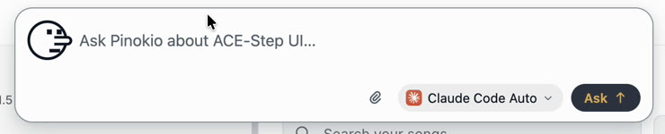
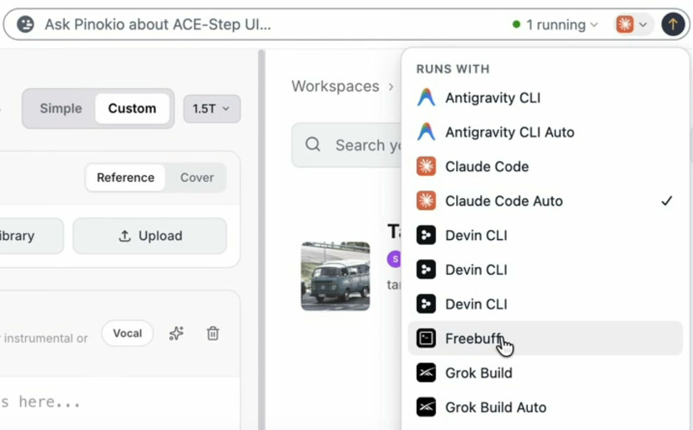
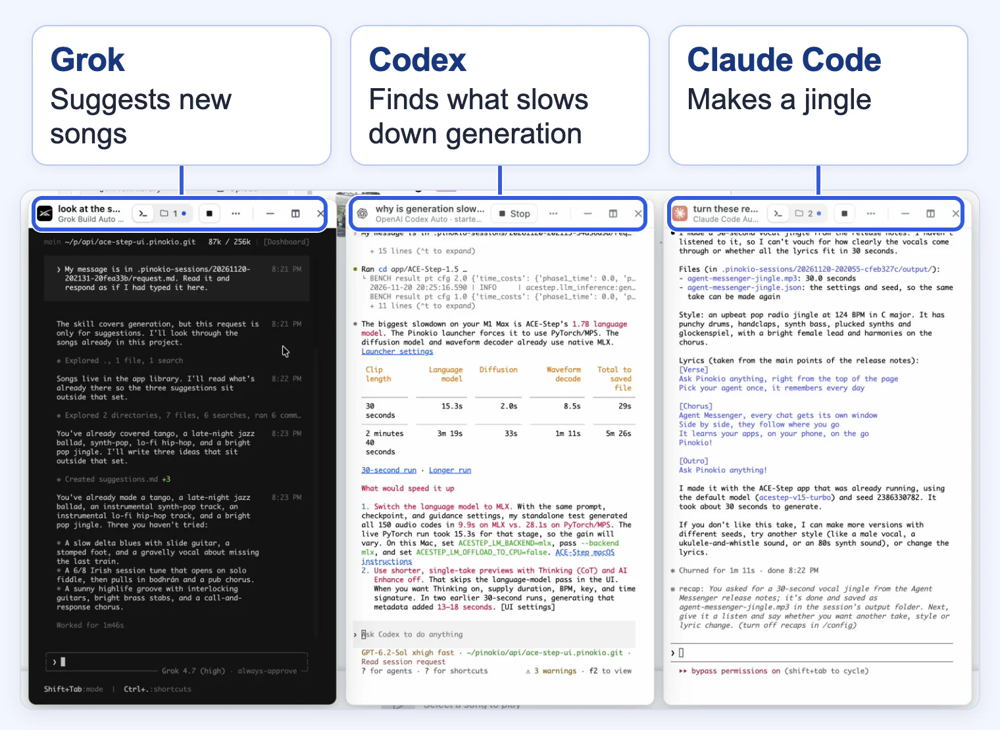
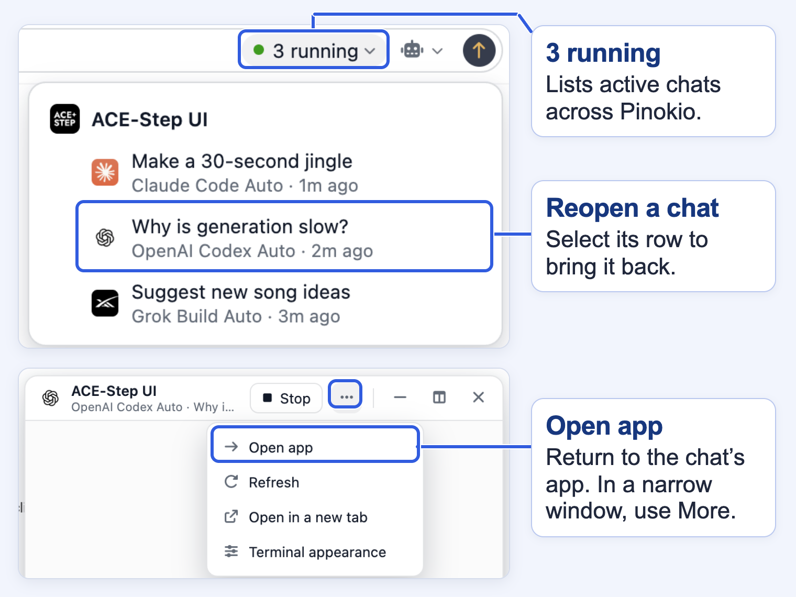
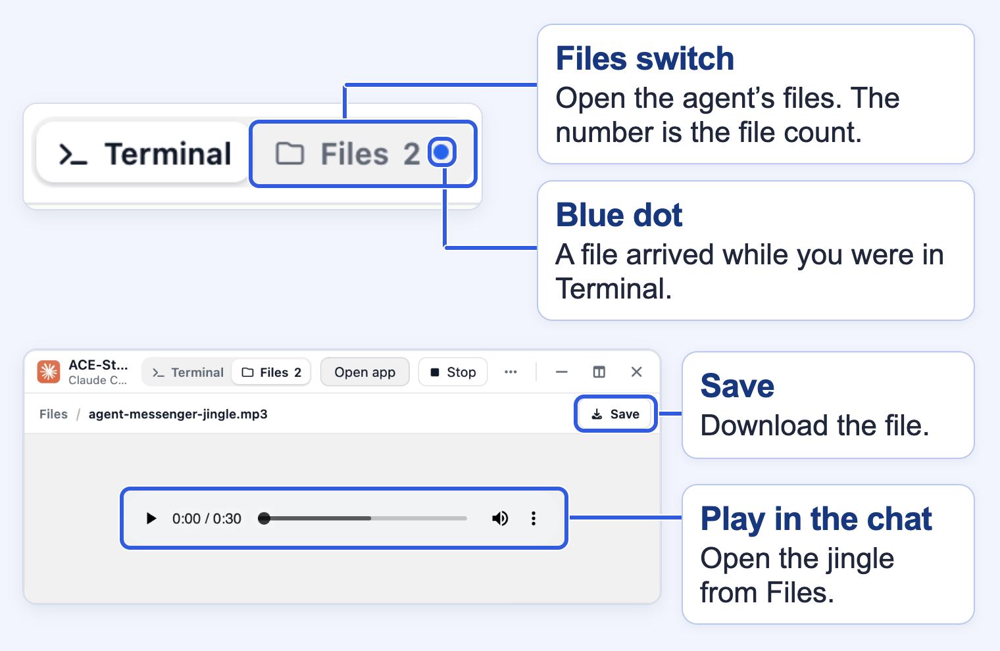
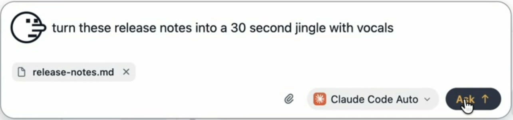
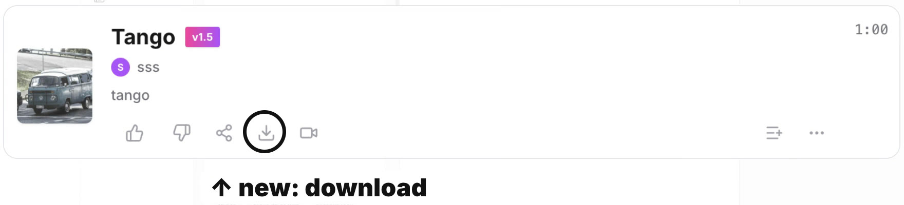
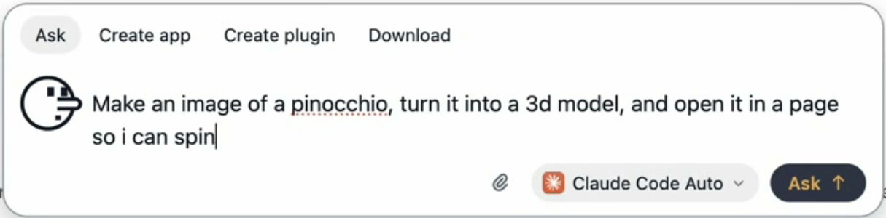
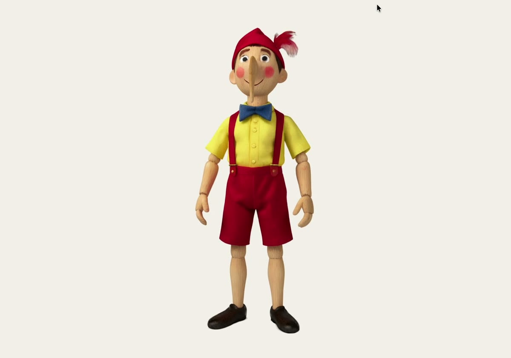

# Agent Messenger

<a class="docs-manual-back-link" data-docs-href="/docs/#/?id=_18-agent-messenger" href="README.md#18-agent-messenger">Back to the Pinokio feature overview</a>

**Chat with the apps on your computer.** Every app in Pinokio has a message box at the top of its page. Type what you need, and an AI agent of your choice answers in its own window, right inside the app, like a messenger. You can ask the app a question, have it do a job, fix a problem, or add something it never had.

From the home screen, you can ask Pinokio itself. You do not need to know which app to use: Pinokio works out the task, decides which apps to talk to, and passes the work from one app to the next.

<video controls playsinline preload="metadata" poster="media/agent-messenger/agent-messenger-poster.png" data-docs-poster="/docs/media/agent-messenger/agent-messenger-poster.png" width="1920" height="1080" aria-label="Pinokio Agent Messenger demonstration">
  <source src="media/agent-messenger/agent-messenger-demo.mp4" data-docs-src="/docs/media/agent-messenger/agent-messenger-demo.mp4" type="video/mp4">
  Your browser does not support embedded video. <a href="/docs/media/agent-messenger/agent-messenger-demo.mp4">Open the Agent Messenger demonstration</a>.
</video>

*The demonstration is narrated. [Read the video transcript](agent-messenger-transcript.md).*

## How it works

Each message you send starts a new chat. Pinokio starts the agent you picked in the app's own folder, hands it your message, and tells it what has already been learned about the app. The agent can then read the app's code and logs, start and stop the app, use it, and change it.

The chat opens in a small window on the page you are on. The window is the agent's own terminal: you watch it work, and you reply by typing in it.

Agent Messenger works with any app installed in Pinokio and with any agent you have as a plugin: Claude Code, Codex, Grok, OpenCode, Antigravity, and more.

## Send a message

On an app's page, the bar at the top says **Ask Pinokio about** and the app's name.

1. Click the bar. It opens into a larger box.
2. Type what you need.
3. Check the agent shown next to **Ask**. Click it to pick another.
4. Click **Ask**, or press Enter.

The agent list shows every agent plugin you have installed. Pinokio remembers the one you picked for next time. Shells for the app are listed at the end of the same menu.

*Agents marked **Auto** run without stopping to ask before each step.*

## Several chats at once

Every message opens its own window. Send another message, and it opens next to the first, so you can keep several agents working on the same app at the same time. Select any image to see it at full size.

### Window controls

The windows follow you from page to page. Each one stays where and how big you left it.

### Find and reopen chats

### Files

The **Files** switch appears when the agent creates a file. You can preview pictures, video, sound, text, and Markdown in the chat while the terminal keeps running underneath.

## What you can ask for

The examples below were all sent to the same music app, ACE-Step, and are shown in the demonstration.

### Ask a question

> why is generation slow on this machine, and what would speed it up

Codex timed each step of making a song and found that one model was running on a slower backend than the rest. It answered with the timings and two ways to speed it up.

### Fix it

> fix it: apply number 1 to this app's launcher

Codex changed the app's launcher so the slow model runs on the faster backend. A 30-second song that took about 35 seconds to make now takes about 23.

### Do a job

> turn these release notes into a 30 second jingle with vocals

Claude Code read the attached file, wrote lyrics from it, started the app, and made the song. The song appeared under **Files** in its window.

### Change it

> add a download button to every song

Claude Code edited the app's code, and a download button appeared on every song in the list.

Fixes and changes are ordinary edits in the app's folder. The **Git** tab on the app's page shows what changed.

## Ask Pinokio from home

The bar on the home screen, and on every other page of Pinokio, says **Ask Pinokio anything**. A message here is not about one app. Pinokio looks at the apps you have, works out which ones the task needs, and uses them one after another.

> Make an image of a pinocchio, turn it into a 3d model, and open it in a page so i can spin

For this one message, Claude Code started Phosphene and had it make the picture, sent the picture to idol to turn it into a 3D model, then wrote a small web page that shows the model and opened it.

The same box has the other things you can start from the bar:

- **Ask:** a message to Pinokio itself.
- **Create app:** describe an app, and an agent builds it in a new folder.
- **Create plugin:** describe a plugin, and an agent builds it. See <a href="/docs/#/?id=building-a-plugin">Building a plugin</a>.
- **Download:** paste a Git URL to download an app or plugin.

To ask about one app without opening it, click the speech bubble on its row on the home screen. The bar then names that app, and the agent starts in that app's folder.

## Attach files

Attach files to a message in any of three ways:

- Click the paperclip in the open message box.
- Drop files on the bar at the top.
- Paste a file or a screenshot into the message.

Attached files show under the message. They are uploaded when you send, and the message tells the agent where they are. On an app's page, they are saved in the app's folder under `.pinokio-temp/uploads`.

## It learns your apps

The first time an agent works with an app, it writes down what it learned, such as how to start the app and how to send it a request. This is saved inside the app's own folder, in `.pinokio-skill`. The next chat about that app, with any agent, starts from there instead of from zero.

Pinokio also remembers which app you want for which kind of task. Name the app in a message from the home screen, for example "use Qwen3-TTS to read this aloud", and the choice is saved. When several apps could do a job and you have not chosen one, the agent finishes the job, then asks once whether to use that app from now on.

## Where each chat is kept

Every chat has its own folder with your message and what the agent made:

- **A chat from an app's page:** in the app's folder, under `.pinokio-sessions`.
- **A chat from the home screen:** in the `brain` folder in your Pinokio home, under `sessions`. The same folder keeps `log.md`, a list of every request, and `preferences.md`, the apps you chose for each kind of task.

## On your phone

The bar and the chat windows also work in a phone's browser, for example through [Remote](remote.md). The message box fills the screen above the on-screen keyboard, and the window ends where the keyboard begins.

## Get Help

When an app fails, **Get Help** on the app's page can build a report from its logs. Choose **Ask AI** there to send the report to an agent. It opens as a chat window like any other message.

## Troubleshooting

### The bar does not show an agent

Install an agent plugin from **Plugins**, or <a href="/docs/#/?id=building-a-plugin">build your own</a>. Any plugin that runs an agent in a terminal can be picked.

### The agent did something different from what I asked

Some agent plugins ignore the message they are given and start empty. Type your message into the window instead, or pick another agent.

### I closed a window by mistake

Closing does not stop the chat. Click **N running** in the bar and open it again.

### The window is gone after the agent finished

A window only stays while its chat is running. What the agent made is still in the chat's folder, described under **Where each chat is kept** above.
