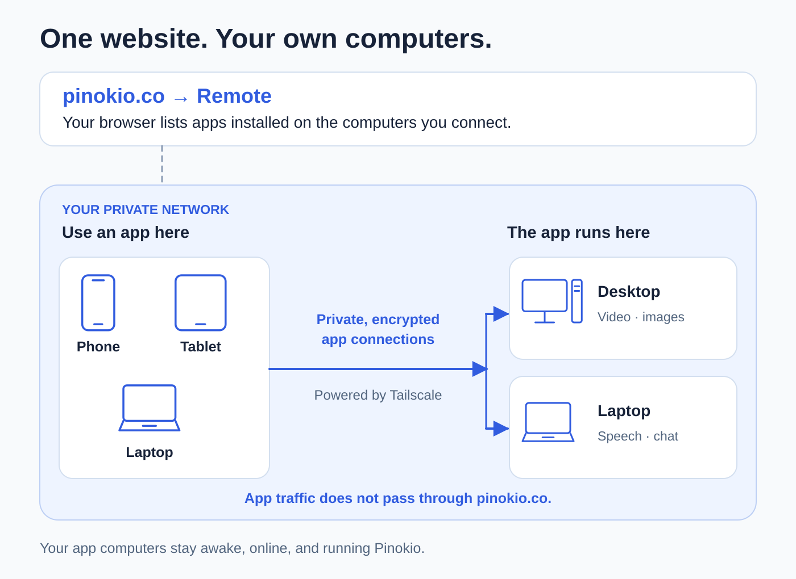
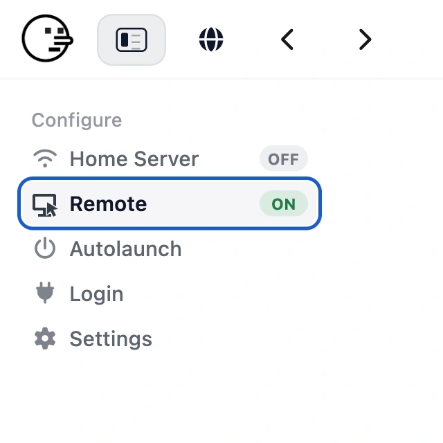
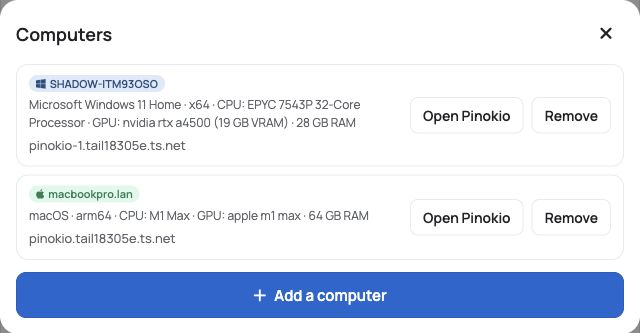
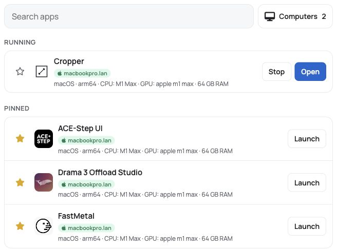
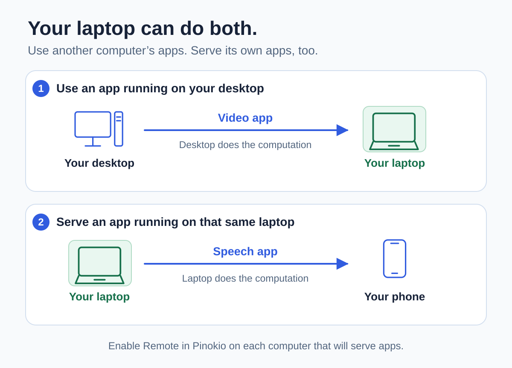

# Remote

<a class="docs-manual-back-link" data-docs-href="/docs/#/?id=_17-remote" href="README.md#17-remote">Back to the Pinokio feature overview</a>

**A personal portal to the apps installed on your computers.** Open the **Remote** tab at [pinokio.co](https://pinokio.co/connect) from your phone, tablet, or another computer. Once you connect your computers, their installed apps appear together, ready to launch and use from your browser.

The Remote tab is available to everyone, without a pinokio.co account or login. Your apps stay on your own computers, reached through private, encrypted connections powered by Tailscale.

<video controls playsinline preload="metadata" poster="media/remote/remote-poster.png" data-docs-poster="/docs/media/remote/remote-poster.png" width="1920" height="1080" aria-label="Pinokio Remote demonstration">
  <source src="media/remote/remote-demo.mp4" data-docs-src="/docs/media/remote/remote-demo.mp4" type="video/mp4">
  Your browser does not support embedded video. <a href="/docs/media/remote/remote-demo.mp4">Open the Remote demonstration</a>.
</video>

*The demonstration has on-screen captions. [Read the video transcript](remote-transcript.md).*

## How it works

<a href="/docs/media/remote/overview.svg" target="_blank" rel="noopener" aria-label="Open diagram at full size">
  <picture>
    <source media="(max-width: 600px)" srcset="/docs/media/remote/overview-mobile.svg">
    
  </picture>
</a>

Pinokio does two jobs for you: it makes the apps on each computer available to your private network, and it brings them together in the Remote tab at pinokio.co. Your browser reads the app list from the computers you connect. Opening an app takes you to that computer's private address.

For example, you can open a video generator from your phone while your desktop's GPU generates the video. The app, models, and computation stay on the desktop; you interact with its web interface from your phone. You can do the same from a tablet or another computer, including over a different Wi-Fi network or a mobile connection.

Remote also works with other web apps served by Pinokio. It opens an app's browser interface; it does not mirror your entire desktop.

## Get connected

You need Pinokio on each computer that will serve apps, and the Tailscale app on each device you will use to access them. The computer serving an app must stay awake, online, and running Pinokio with Remote turned on.

**A computer can need both.** Pinokio includes its own Tailscale service to make that computer's apps available. To use another computer's apps from its browser, install and connect the Tailscale app there too. Turning on Remote in Pinokio does not replace this step.

### 1. Choose apps for your computer

If you are starting from scratch, [download Pinokio](https://desktop.pinokio.co) and browse the [app catalog](https://pinokio.co/apps). Choose an app and use its one-click installer on your computer. Each app still needs compatible hardware and any models or dependencies it uses.

Already have apps installed in Pinokio? You can use those. You do not need to reinstall them for Remote.

### 2. Open Remote in Pinokio

On the computer that will run your apps, open **Remote** under **Configure** in Pinokio's sidebar.

*The screenshot omits the middle navigation rows to highlight where Remote lives.*

Follow the setup prompts:

1. Let Pinokio install the required components if prompted. Pinokio includes its own Tailscale service for serving apps.
2. If Remote is off, choose **Turn on**.
3. Choose **Sign in with Tailscale** and sign in. Use the same Tailscale account when connecting your other devices.
4. If your network requires device approval, approve the Pinokio device in Tailscale's admin console.
5. If **One more approval** appears, complete the approval that opens in your browser. If it does not open, choose **Approve in Tailscale**. As an alternative, use **Open DNS settings** and enable **HTTPS Certificates** in Tailscale's admin console.

When ready, Remote shows two connection options: **Connect a phone or tablet**, with a QR code, and **Connect another computer**, with a **Copy link** button. Keep this screen available for the next step.

### 3. Connect from your phone, tablet, or another computer

1. Open the connection page on the device you want to use:
   - **Phone or tablet:** scan the QR code on your computer's Remote screen with the device's camera, then open the link.
   - **Another computer:** choose **Copy link** on the computer serving your apps, then open that link in the other computer's browser.
2. Follow the page's instructions to [install Tailscale](https://tailscale.com/download). Open Tailscale, sign in with the same account shown on the computer's Remote screen, and allow the VPN prompt when it appears. If Tailscale is already installed, make sure it is connected with that account.
3. Return to the connection page. It saves the computer in this browser and connects automatically once Tailscale is connected. Its installed apps then appear in the Remote tab.

No pinokio.co account or website login is needed. Tailscale sign-in connects your devices to their private network.

**Starting from the Remote tab instead?** Go to [pinokio.co Remote](https://pinokio.co/connect) and choose **Connect to computer**. If you already have a computer saved, choose **Computers → Add a computer**. Follow the Tailscale setup instructions, paste the link from your computer's Remote screen into the **Computer address** field, and choose **Connect**. The field also accepts a private address such as `https://pinokio.tail1234.ts.net`. On a phone, you can use **Scan QR code** in this dialog instead of pasting a link.

*Choose Add a computer to open the connection instructions. Use the link or QR code shown on your own computer; the names and addresses above belong to the demonstration machines.*

Repeat the computer setup for any other computers you want to serve apps, then connect them here. Their apps appear in the same view.

**Connect your computers in each browser you use.** Saved computers and pinned apps are stored locally in that browser and are not synced between browsers or devices. A new browser, another device, or cleared site data starts with an empty list. Add your computers there too; you do not need to reinstall their apps or repeat Tailscale setup on devices that are already connected.

## Use your installed apps

*Each app's computer badge tells you where it is installed. The screenshot is cropped to keep the controls readable.*

- **Launch**: Starts the app on the computer named in its badge. If the app offers several launch options, choose one from the menu.
- **Open**: Opens the running app's web interface at its private address in a new browser tab.
- **Stop**: Stops the app on its computer after confirmation. This also affects anyone using that same running app.
- **Running**: Shows running apps and apps that are starting. An app needs to finish startup before its web interface can open.
- **Pinned**: Keeps starred apps easy to find, including when they are stopped.
- **All apps**: Lists installed apps reported by your reachable computers. They do not all need to be running.
- **Search apps**: Filters apps across your connected computers.
- **Computers**: Shows your saved computers. Choose **Add a computer** to connect another, **Open Pinokio** to open a computer's full Pinokio interface, or **Remove** to remove its entry from this browser.

After opening an app, switch back to the pinokio.co tab to return to the portal. The app continues to run on its computer until it stops or you stop it.

Removing a computer from **Computers** only removes its saved entry and pins in this browser. It does not uninstall apps or turn off Remote on that computer.

## A computer can do both jobs

You do not need a separate class of “server” computers. A laptop can use an app running on your desktop, then serve one of its own apps to your phone or desktop.

<a href="/docs/media/remote/two-roles.svg" target="_blank" rel="noopener" aria-label="Open diagram at full size">
  <picture>
    <source media="(max-width: 600px)" srcset="/docs/media/remote/two-roles-mobile.svg">
    
  </picture>
</a>

To use the desktop's apps, connect the Tailscale app on the laptop and add the desktop in the laptop's browser. To serve the laptop's own apps, install them in Pinokio on that laptop and enable Remote there too. Add the laptop in the browsers you want to use to access it.

Some useful combinations:

- **A lightweight laptop and a GPU desktop:** use the desktop's image or video apps from the laptop's browser.
- **Different apps on different computers:** keep a speech app on a Mac and a video app on a Windows machine, then open either from the same portal. Each app runs on hardware it supports.
- **A tablet as a workspace:** use a larger touch screen to interact with an app while the model and computation remain on your computer.
- **Access from another network:** use your connected phone or laptop over mobile data or another Wi-Fi network while your app computer remains online.

## What stays private

**A public entry point does not make your apps public.** Pinokio Remote uses Tailscale's private network to connect your devices. Merely visiting pinokio.co or knowing a computer's address does not give someone access to its apps. Access depends on membership and permissions in your Tailscale network.

The browser loads the Remote page from pinokio.co, then contacts your paired computers over that private network. Remote saves the computer list and pins locally in your browser. App traffic goes between your device and the computer serving the app, rather than through pinokio.co's servers.

Pinokio uses [Tailscale Serve](https://tailscale.com/docs/features/tailscale-serve) for private access. It does not enable public Tailscale Funnel access. You do not need to forward a port on your router.

Tailscale attempts a direct peer-to-peer connection. If the network prevents that, it can use a relay; the connection remains end-to-end encrypted. See [Tailscale connection types](https://tailscale.com/docs/reference/connection-types).

This describes the Remote connection. Each app's own behavior still matters: an app that calls an external API can continue to do so. Remote does not turn such an app into an offline app.

## Troubleshooting

### I do not see Remote

In the **Pinokio desktop app**, update Pinokio and reopen it. Look under **Configure**, below **Home Server**.

On **pinokio.co**, open the **Remote** tab or [go directly to Remote](https://pinokio.co/connect). No pinokio.co account is required.

### The portal is empty

The Remote tab shows apps from computers you have connected in this browser. If no computers are saved, choose **Connect to computer**. To add another, choose **Computers → Add a computer**. Paste the link from your computer's Remote screen and choose **Connect**, or use **Scan QR code** on a phone.

If this is a new computer with no apps yet, install an app from the catalog in Pinokio on that computer, then return to Remote.

### A computer cannot be reached

Check that the computer is awake and online, Pinokio is running, and its Remote page is connected. On the device you are browsing from, make sure the Tailscale app is connected with the same account. This also applies to a laptop or desktop with its own Pinokio Remote turned on. On a first connection, **Waiting for Tailscale** updates automatically when the connection succeeds. For a previously connected computer, choose **Retry** if it is shown.

If the host's Remote page asks for sign-in, device approval, or HTTPS setup, finish that step there. If your browser asks for local-network access, allow it for pinokio.co so it can reach your computers.

You can try opening the computer's private address directly. If that also fails, first resolve the Tailscale connection or host availability. A computer's installed apps may disappear from the portal while it is unreachable; its saved entry remains in **Computers**.

### An app is stuck starting, or Open is missing

The app must start and expose a web interface before **Open** is available. Its first launch may need downloads or model loading. Use **Computers → Open Pinokio** to inspect that computer's app and terminal output. If Remote says the computer needs an update, update Pinokio there.

### It works on my phone, but my laptop has an empty list

Connect the Tailscale app on the laptop, then add the same computers in the laptop's browser. The list and pins are saved separately in each browser.

### Does the app computer need to stay on?

Yes. The app runs there. Keep it awake, connected, and running Pinokio with Remote enabled. Remote does not wake a sleeping computer or move its computation to pinokio.co.

### How do I turn off access?

Open **Remote** in Pinokio on the computer serving apps and click the **On** switch at the top to turn it off. You can also choose **Turn off** in the Details section when it is visible. To change the Tailscale account, choose **Sign out**, confirm, and sign in with the other account. Removing an entry from the browser's **Computers** list does not disable that computer's Remote connection.

### Why does setup ask for HTTPS?

HTTPS lets browsers use features such as the camera and microphone with your apps. Enabling certificates does not make the apps publicly reachable. Certificates do put the machine's certificate name in public Certificate Transparency logs; avoid sensitive information in device names. See [Tailscale's HTTPS documentation](https://tailscale.com/docs/how-to/set-up-https-certificates).
